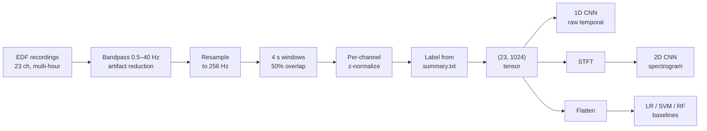

# EEG Seizure Detection

Detecting epileptic seizures from raw multi-channel EEG recordings, and a study of why a model can score 99.9% accuracy while detecting exactly zero seizures.

<picture>
  <source media="(prefers-color-scheme: dark)" srcset="docs/images/results-dark.svg">
  
</picture>

## The problem

Epileptic seizures show up in EEG as sudden abnormal electrical activity, but finding them means a neurologist manually reading multi-hour, 23-channel recordings — slow, expensive, and error-prone. Automating that is a well-studied ML problem with a nasty property: seizures occupy a tiny fraction of any recording, so the dataset is severely imbalanced. This project builds the full pipeline — EDF ingestion through preprocessing, windowing, labeling, and five models — and evaluates it with metrics that survive that imbalance.

## Pipeline



## Results

Test-set performance across all five models:

| Model | Accuracy | Sensitivity | Specificity | AUC |
|---|---|---|---|---|
| Logistic Regression | 0.996 | **0.000** | 1.000 | 0.506 |
| SVM (RBF) | 0.999 | **0.000** | 1.000 | 0.567 |
| Random Forest | 0.999 | **0.000** | 1.000 | 0.615 |
| 2D CNN (spectrogram) | 0.9999 | **0.000** | 1.000 | 0.976 |
| 1D CNN (raw) | 0.9998 | **0.000** | 1.000 | 0.999 |

**False alarms per hour: 0.00** — trivially, because no model ever raises an alarm.

### Why accuracy is the wrong headline metric

A seizure occupies roughly 3–6% of a recording at most, and far less in the subsets used here. A model that outputs "no seizure" unconditionally therefore scores near-perfect accuracy while being clinically worthless. That is precisely what every model in the table above does: accuracy ≥ 0.996, specificity 1.000, and sensitivity **0.000** — not a single seizure window was ever predicted positive.

Accuracy hides this completely. Sensitivity exposes it in one number.

### The interesting part: high AUC, zero sensitivity

The baselines and the CNNs fail the same way at the decision layer, but they are not equivalent underneath.

- Baselines sit at **AUC 0.506–0.615** — barely better than a coin flip. They learned close to nothing.
- The CNNs reach **AUC 0.976 and 0.999**. They learned to rank seizure windows above non-seizure ones almost perfectly.

AUC is threshold-free: it asks "is a seizure window scored higher than a non-seizure window?", never "does this score cross 0.5 and become a positive prediction?" So a model can order the data nearly perfectly and still never cross the threshold. The CNNs learned a genuinely discriminative representation; what failed was the operating point, not the features.

The fix is threshold selection, not a new architecture — sweep the decision threshold, pick the point on the ROC curve that hits a target sensitivity, and accept the false-alarm rate that comes with it. In seizure detection you would tolerate a substantial false-alarm rate to get sensitivity meaningfully above zero, because a missed seizure costs far more than a spurious alert. Class-weighted loss (implemented via `--use-class-weights`) and focal loss attack the same problem during training rather than after it.

> **On the AUC figures.** Train/val/test splits are random over 4-second windows with 50% overlap, so a window and its overlapping neighbour — sharing two seconds of identical signal — can land on opposite sides of the split. The reported AUC is optimistic as a result, and a patient-independent split would be the honest evaluation. See [Limitations](#limitations).

## How it works

### Preprocessing

Recordings arrive as EDF, read via MNE-Python. Each is bandpass filtered to **0.5–40 Hz** (dropping DC drift and high-frequency muscle noise outside the band where seizure activity lives) and resampled to **256 Hz**, since some sessions were recorded at 512 Hz.

Filtered signal is cut into **4-second windows with 50% overlap** — 1024 samples per channel, windows starting at 0–4 s, 2–6 s, 4–8 s, and so on. Overlap multiplies the number of training examples, which matters when the positive class is this rare. Each window is z-normalized per channel, so the model sees relative signal shape rather than absolute microvolt scale, which varies by electrode and session.

Labels come from parsing each patient's `chbNN-summary.txt`; a window is positive if it overlaps any annotated seizure interval.

### Models

Three approaches on the identical `(23, 1024)` window:

**1D CNN** — four conv blocks (kernel 7→5→5→3, channels 64→128→256→256) convolving along time across all 23 channels, then global average pooling into a 2-class head. Treats EEG as what it is: a multi-channel time series. ~700K parameters.

**2D CNN** — averages the 23 channels into one signal, computes an STFT spectrogram, and runs three conv blocks (32→64→128) over it as a single-channel image. Captures time–frequency structure that a purely temporal model can miss, at the cost of discarding per-channel spatial information. ~93K parameters.

**Classical baselines** — Logistic Regression, RBF SVM, and Random Forest on the window flattened to a 23,552-dimensional vector, all with balanced class weights. They exist to establish what a model with no temporal or spectral inductive bias achieves on this problem. The answer, per the table, is essentially nothing.

### Key decisions

- **Global average pooling instead of flatten-then-dense** in both CNNs, keeping the classifier head independent of input length and cutting parameters sharply.
- **Checkpoint selection on validation AUC, not accuracy.** Accuracy is ~1.0 for a model that never predicts a seizure, so it cannot distinguish a good epoch from a bad one. AUC can.
- **Per-window rather than per-recording normalization**, so the model is robust to inter-session amplitude drift.

## Repository structure

```
src/
  data_loader.py     CHB-MIT EDF loading, windowing, labeling, spectrograms
  models.py          CNN1D and CNN2D architectures
  metrics.py         Shared accuracy / sensitivity / specificity / AUC
  train_utils.py     Shared train and validation loops, split helper
  train_1dcnn.py     1D CNN training entry point
  train_cnn2d.py     2D CNN training entry point
  baseline_models.py Logistic Regression / SVM / Random Forest baselines
docs/
  final-report.pdf   Written report
  presentation.pdf   Slide deck
```

## Tech stack

Python · PyTorch · MNE-Python · scikit-learn · SciPy · NumPy

## Setup

```bash
git clone https://github.com/hargens-holland/EEGSeizureDetectionModel.git
cd EEGSeizureDetectionModel

python -m venv .venv && source .venv/bin/activate
pip install -r requirements.txt
```

Download the [CHB-MIT Scalp EEG Database](https://physionet.org/content/chbmit/1.0.0/) — PhysioNet is the canonical source; this project used a Kaggle mirror of it — and arrange it as:

```
data/
  chb01/
    chb01_01.edf
    chb01-summary.txt
  chb02/
    ...
```

The full dataset is roughly 40 GB. The `--max-*` flags cap how much gets loaded, which is how you run this on a laptop:

```bash
# 1D CNN on a small subset, with class-weighted loss
python src/train_1dcnn.py --data ./data --epochs 10 \
    --max-patients 2 --max-windows 5000 --use-class-weights

# 2D CNN on spectrograms
python src/train_cnn2d.py --data ./data --epochs 30 --max-patients 2

# Classical baselines
python src/baseline_models.py --data ./data --model all
```

Each training script writes its best checkpoint to `cnn1d.pth` / `cnn2d.pth` (gitignored) and prints test accuracy, sensitivity, specificity, and AUC.

## Limitations

- **Splits are random over overlapping windows, not patient-independent.** Overlapping neighbours can straddle the train/test boundary, which inflates the reported AUC. A patient-independent split — hold out whole patients — is the correct evaluation and would produce lower, more trustworthy numbers.
- **No model achieves non-zero sensitivity at the default threshold.** No threshold sweep was run, so the usable operating point of the CNNs is unmeasured.
- **Trained on a subset.** Compute limits meant training on a small number of patients rather than all 23, and seizure morphology varies enormously between individuals.
- **Cross-patient generalization is untested and is the central open problem** in this task.
- **No trained checkpoint is committed to this repository.** The metrics above are reproduced from the project report; the training runs that produced them were not preserved.

## Credits

ECE 539 (Introduction to Artificial Neural Networks), University of Wisconsin–Madison — Team 3.

| | |
|---|---|
| **Holland Hargens** | 2D CNN architecture and spectrogram pipeline; final report and presentation; this repository's restructuring, documentation, and threshold analysis |
| **Stephen Bail** | 1D CNN architecture; revisions to the 2D CNN training script; evaluation and literature review |
| **Kushal Mishra** | Classical baselines (logistic regression, SVM, random forest) |
| **Donovan Johnson** | EDF data loader and windowing pipeline |

This was a team project and the commit history reflects it. My own contributions are the 2D CNN and its spectrogram preprocessing, plus the analysis and packaging in this repository.

## References

1. [Epileptic Seizure Detection Using Machine Learning: A Systematic Review](https://pmc.ncbi.nlm.nih.gov/articles/PMC12190198/)
2. [EEG Datasets for Seizure Detection and Prediction — A Review](https://pmc.ncbi.nlm.nih.gov/articles/PMC10235576/)
3. Ali, E., et al. [Epileptic Seizure Detection Using CHB-MIT Dataset: The Overlooked Perspectives](https://royalsocietypublishing.org/doi/abs/10.1098/rsos.230601). *Royal Society Open Science*, 2024.
4. Acharya, U. R., et al. [Deep convolutional neural network for the automated detection and diagnosis of seizure using EEG signals](https://pubmed.ncbi.nlm.nih.gov/28974302/). *Computers in Biology and Medicine*, vol. 100, pp. 270–278, 2018.
5. Roy, S., et al. [Seizure detection using CNN and LSTM based hybrid model](https://arxiv.org/abs/1903.08100). arXiv:1903.08100, 2019.
