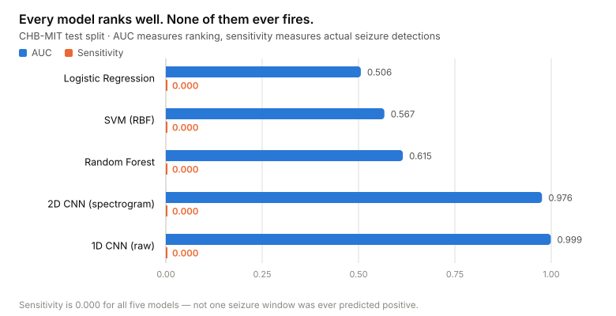
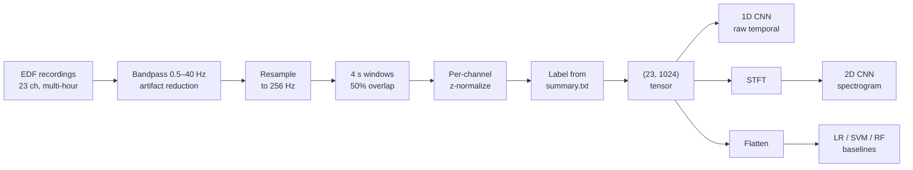

# EEG Seizure Detection

Detecting epileptic seizures from raw multi-channel EEG recordings — and a study of why a model can score 99.9% accuracy while detecting exactly zero seizures.

<picture>
  <source media="(prefers-color-scheme: dark)" srcset="docs/images/results-dark.svg">
  
</picture>

## The problem

Epileptic seizures show up in EEG as sudden abnormal electrical activity, but finding them means a neurologist manually reading multi-hour, 23-channel recordings — slow, expensive, and error-prone. Automating that is a well-studied ML problem with a nasty property: seizures occupy a tiny fraction of any recording, so the dataset is severely imbalanced. This project builds the full pipeline — EDF ingestion through preprocessing, windowing, labeling, and five models — and evaluates it with metrics that survive that imbalance.

## Pipeline



## Results

Test-set performance across all five models, from the original course run. These numbers were produced under a **random window-level split** — see [Evaluation](#evaluation) for why that inflates AUC, and why the repository now defaults to a recording-level split.

| Model | Accuracy | Sensitivity | Specificity | AUC |
|---|---|---|---|---|
| Logistic Regression | 0.996 | **0.000** | 1.000 | 0.506 |
| SVM (RBF) | 0.999 | **0.000** | 1.000 | 0.567 |
| Random Forest | 0.999 | **0.000** | 1.000 | 0.615 |
| 2D CNN (spectrogram) | 0.9999 | **0.000** | 1.000 | 0.976 |
| 1D CNN (raw) | 0.9998 | **0.000** | 1.000 | 0.999 |

**False alarms per hour: 0.00** — trivially, because no model ever raises an alarm.

### Why accuracy is the wrong headline metric

A seizure occupies roughly 3–6% of a recording at most, and the positive class in these runs was smaller still (see [What revisiting the project turned up](#what-revisiting-the-project-turned-up)). A model that outputs "no seizure" unconditionally therefore scores near-perfect accuracy while being clinically worthless. That is precisely what every model in the table above does: accuracy ≥ 0.996, specificity 1.000, and sensitivity **0.000** — not a single seizure window was ever predicted positive.

Accuracy hides this completely. Sensitivity exposes it in one number.

### High AUC, zero sensitivity

The baselines and the CNNs fail the same way at the decision layer, but they are not equivalent underneath.

- Baselines sit at **AUC 0.506–0.615** — barely better than a coin flip. They learned close to nothing.
- The CNNs reach **AUC 0.976 and 0.999**. They learned to rank seizure windows above non-seizure ones almost perfectly — *on this split*.

AUC is threshold-free: it asks "is a seizure window scored higher than a non-seizure window?", never "does this score cross 0.5 and become a positive prediction?" So a model can order the data nearly perfectly and still never cross the threshold. The CNNs learned a discriminative representation; what failed was the operating point, not the features.

The fix is threshold selection, not a new architecture — choose the decision threshold on a validation split to hit a target sensitivity, and accept the false-alarm rate that comes with it. In seizure detection you would tolerate a substantial false-alarm rate to get sensitivity meaningfully above zero, because a missed seizure costs far more than a spurious alert. That is what the evaluation protocol below does.

## Evaluation

The scripts in this repository evaluate the way a seizure-detection paper would, and every entry point — both CNNs, the baselines, and the threshold sweep — shares the same code path in [`src/train_utils.py`](src/train_utils.py).

> **Status: recording-level evaluation in progress.** The protocol below is implemented and tested on synthetic data, but has not yet been run on CHB-MIT. The only real numbers in this README are the course results above, from the window-level split.

**Recording-level split.** Windows overlap by 50%, so any two neighbours share two seconds of identical signal. A random split over windows puts a test window's neighbour in training more often than not; the model is then partly scored on how well it recognises near-copies of what it has already seen. The default split (`--split recording`) instead assigns each EDF file wholesale to train, val, or test, so no signal in the test set has been seen during training. Recordings that contain a seizure are rare — a handful per patient — so they are allocated separately from seizure-free recordings, guaranteeing every split has positive windows. The original window-level split is kept as `--split window` so the leaky result can be reproduced and compared.

**Threshold chosen on validation, reported on test.** After training, the script sweeps the decision threshold on the *validation* split and picks the one with the highest sensitivity whose false-alarm rate stays within a budget (`--fa-budget`, default 5 per hour; falls back to Youden's J if nothing qualifies). It then reports test sensitivity, specificity, false alarms per hour, and AUC at that fixed threshold — alongside the same numbers at the default 0.5, so the effect of choosing an operating point is visible in one place. Tuning the threshold on test and then reporting test numbers would be a second, subtler form of leakage.

**Checkpoint selection on validation AUC, not accuracy.** Accuracy is ~1.0 for a model that never predicts a seizure, so it cannot distinguish a good epoch from a bad one.

[`src/threshold_sweep.py`](src/threshold_sweep.py) runs the same selection over an existing checkpoint and prints the full sensitivity / false-alarm curve, for choosing a different budget without retraining.

## What revisiting the project turned up

Two problems surfaced when I came back to package this repository. Both are fixed; both are worth knowing about because the results table above predates them.

**Seizure windows were under-labeled by roughly 10×.** The original loader read each seizure's *onset* from `chbNN-summary.txt` and labeled a window positive if its start fell within four seconds of that onset. Seizure *end* times were never parsed, so every seizure — whether it lasted 10 seconds or 3 minutes — produced at most two positive windows. CHB-MIT seizures average around a minute, which at 4 s / 50% overlap should be about 30 positive windows each. The loader now captures `(onset, end)` intervals and labels a window positive if any part of it overlaps any interval. This made an already severe imbalance far worse and is a likely contributor to the zero-sensitivity result.

**The split leaked.** As described under [Evaluation](#evaluation), the course results used a random window-level split. The 0.976 and 0.999 AUCs are best read as "the CNNs can separate seizure windows from their own near-duplicates", not as a generalisation claim. The recording-level split is now the default.

## How it works

### Preprocessing

Recordings arrive as EDF, read via MNE-Python. Each is bandpass filtered to **0.5–40 Hz** (dropping DC drift and high-frequency muscle noise outside the band where seizure activity lives) and resampled to **256 Hz**, since some sessions were recorded at 512 Hz.

Filtered signal is cut into **4-second windows with 50% overlap** — 1024 samples per channel, windows starting at 0–4 s, 2–6 s, 4–8 s, and so on. Overlap multiplies the number of training examples, which matters when the positive class is this rare. Each window is z-normalized per channel, so the model sees relative signal shape rather than absolute microvolt scale, which varies by electrode and session.

Labels come from parsing each patient's `chbNN-summary.txt`; a window is positive if it overlaps any annotated seizure interval.

### Models

Three approaches on the identical `(23, 1024)` window:

**1D CNN** — four conv blocks (kernel 7→5→5→3, channels 64→128→256→256) convolving along time across all 23 channels, then global average pooling into a 2-class head. Treats EEG as what it is: a multi-channel time series. ~414K parameters.

**2D CNN** — averages the 23 channels into one signal, computes an STFT spectrogram, and runs three conv blocks (32→64→128) over it as a single-channel image. Captures time–frequency structure that a purely temporal model can miss, at the cost of discarding per-channel spatial information. ~93K parameters.

**Classical baselines** — Logistic Regression, RBF SVM, and Random Forest on the window flattened to a 23,552-dimensional vector, all with balanced class weights. They exist to establish what a model with no temporal or spectral inductive bias achieves on this problem. The answer, per the table, is essentially nothing.

### Key decisions

- **Global average pooling instead of flatten-then-dense** in both CNNs, keeping the classifier head independent of input length and cutting parameters sharply.
- **Per-window rather than per-recording normalization**, so the model is robust to inter-session amplitude drift.

## Repository structure

```
src/
  data_loader.py     CHB-MIT EDF loading, windowing, interval labeling, spectrograms
  models.py          CNN1D and CNN2D architectures
  metrics.py         Accuracy / sensitivity / specificity / AUC
  train_utils.py     Recording-level split, threshold selection, train/val loops
  train_1dcnn.py     1D CNN training entry point
  train_cnn2d.py     2D CNN training entry point
  baseline_models.py Logistic Regression / SVM / Random Forest baselines
  threshold_sweep.py Sensitivity / false-alarm curve over a trained checkpoint
docs/
  final-report.pdf   Written report
  presentation.pdf   Slide deck
LICENSE              MIT
```

The [final report](docs/final-report.pdf) and [slide deck](docs/presentation.pdf) are the versions submitted for the course. One caveat: the report's narrative describes the 2D CNN as achieving "the strongest sensitivity" of the models; its own results table shows 0.000 for every model, and the table is correct. This README supersedes the report where they disagree.

## Tech stack

Python · PyTorch · MNE-Python · scikit-learn · SciPy · NumPy

## Setup

```bash
git clone https://github.com/hargens-holland/EEGSeizureDetectionModel.git
cd EEGSeizureDetectionModel

python -m venv .venv && source .venv/bin/activate
pip install -r requirements.txt
```

Download the [CHB-MIT Scalp EEG Database](https://physionet.org/content/chbmit/1.0.0/) — PhysioNet is the canonical source; this project used a Kaggle mirror of it — and arrange it as:

```
data/
  chb01/
    chb01_01.edf
    chb01-summary.txt
  chb02/
    ...
```

The full dataset is roughly 40 GB. The `--max-*` flags cap how much gets loaded, which is how you run this on a laptop. Two patients is enough for a recording-level evaluation (chb01 and chb02 together have ten seizure recordings); it is not enough for a patient-independent one.

```bash
# 2D CNN on spectrograms, recording-level split, threshold chosen on validation
python src/train_cnn2d.py --data ./data --epochs 30 --max-patients 2

# 1D CNN with class-weighted loss
python src/train_1dcnn.py --data ./data --epochs 10 --max-patients 2 --use-class-weights

# Classical baselines on the same split
python src/baseline_models.py --data ./data --max-patients 2 --model random_forest

# Reproduce the original leaky evaluation for comparison
python src/train_cnn2d.py --data ./data --epochs 30 --max-patients 2 --split window

# Re-examine a saved checkpoint at a different false-alarm budget
python src/threshold_sweep.py --data ./data --checkpoint cnn2d.pth --model 2d --fa-budget 2
```

Each training script writes its best checkpoint to `cnn1d.pth` / `cnn2d.pth` (gitignored) and prints test AUC, then sensitivity / specificity / false alarms per hour at both the default threshold and the validation-chosen one.

## Limitations

- **The results table is from the course run**, under the window-level split and the original labels. It is kept because it is the result the project was graded on and because the accuracy-vs-sensitivity story it tells holds regardless. The recording-level protocol has not yet been run on real data; when it is, its numbers will replace the table and will be lower and more trustworthy.
- **Cross-patient generalisation is untested.** The recording-level split holds out files within patients, which is the standard patient-specific CHB-MIT evaluation. Holding out entire patients is the stronger claim, needs many more patients than a laptop run loads, and is the central open problem in this task — seizure morphology varies enormously between individuals.
- **Trained on a subset.** Compute limits meant training on a small number of patients rather than all 23.
- **No trained checkpoint is committed.** The metrics above are reproduced from the project report; the training runs that produced them were not preserved.

## Credits

ECE 539 (Introduction to Artificial Neural Networks), University of Wisconsin–Madison — Team 3.

| | |
|---|---|
| **Holland Hargens** | 2D CNN architecture and spectrogram pipeline; final report and presentation; this repository's restructuring, documentation, evaluation protocol (recording-level split, threshold selection), and the labeling fix |
| **Stephen Bail** | 1D CNN architecture; revisions to the 2D CNN training script; evaluation and literature review |
| **Kushal Mishra** | Classical baselines (logistic regression, SVM, random forest) |
| **Donovan Johnson** | EDF data loader and windowing pipeline |

This was a team project and the commit history reflects it. My own contributions are the 2D CNN and its spectrogram preprocessing, plus the analysis, evaluation protocol, and packaging in this repository.

## References

1. [Epileptic Seizure Detection Using Machine Learning: A Systematic Review](https://pmc.ncbi.nlm.nih.gov/articles/PMC12190198/)
2. [EEG Datasets for Seizure Detection and Prediction — A Review](https://pmc.ncbi.nlm.nih.gov/articles/PMC10235576/)
3. Ali, E., et al. [Epileptic Seizure Detection Using CHB-MIT Dataset: The Overlooked Perspectives](https://royalsocietypublishing.org/doi/abs/10.1098/rsos.230601). *Royal Society Open Science*, 2024.
4. Acharya, U. R., et al. [Deep convolutional neural network for the automated detection and diagnosis of seizure using EEG signals](https://pubmed.ncbi.nlm.nih.gov/28974302/). *Computers in Biology and Medicine*, vol. 100, pp. 270–278, 2018.
5. Roy, S., et al. [Seizure detection using CNN and LSTM based hybrid model](https://arxiv.org/abs/1903.08100). arXiv:1903.08100, 2019.
